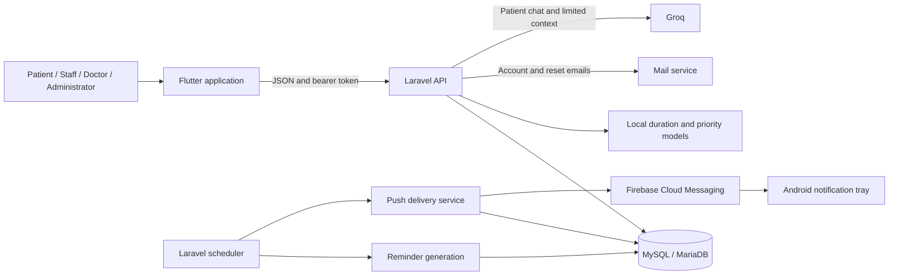
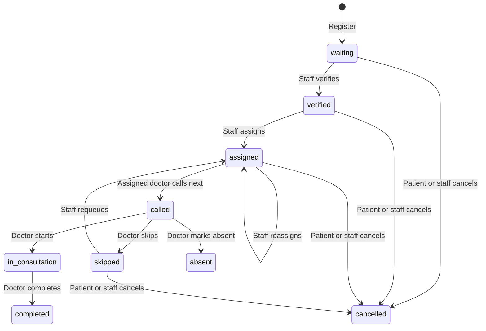
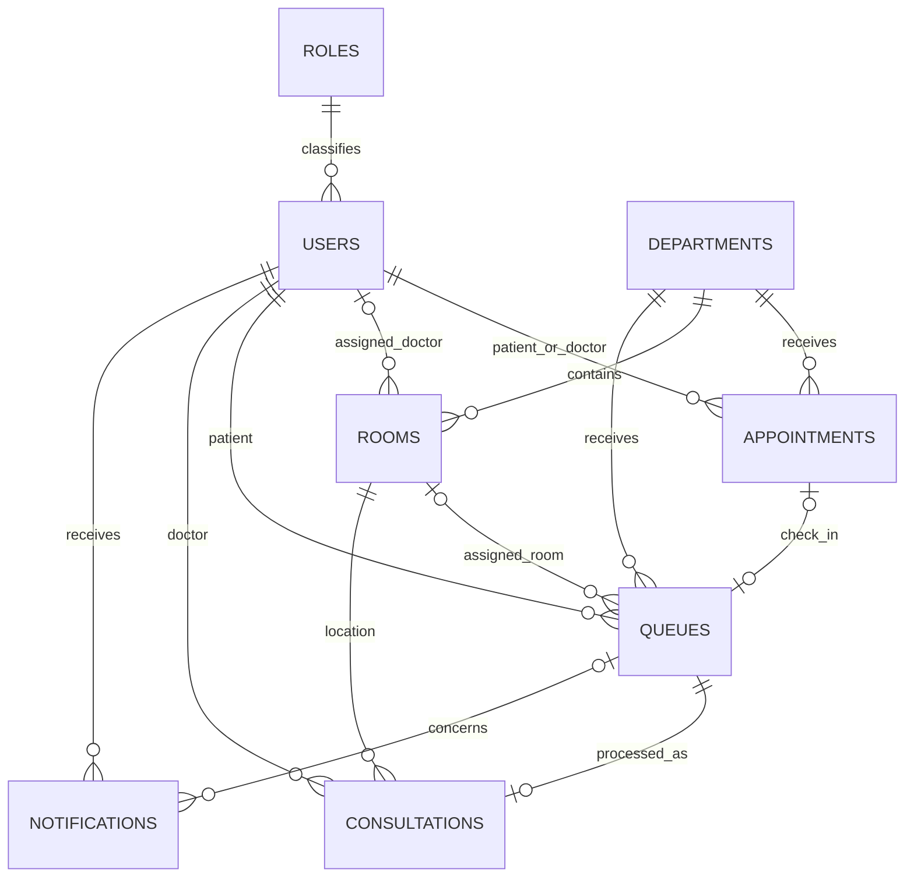

# Smart Queue System: detailed implementation reference

Reviewed against repository source on **14 November 2026**. This document describes the implementation in this workspace, rather than only the original proposal or prototype. It is suitable as source material for the system design, implementation, user manual, database, testing, and limitations chapters of project documentation.

**Evidence boundary:** source files, schema scripts, migrations, and test definitions were inspected. The live database, deployed server, real email delivery, physical devices, and model accuracy were not verified for this documentation update. Defaults below are source defaults, not a claim about the current contents of a running clinic database. Credentials and actual patient records are deliberately excluded.

## Contents

1. [Purpose, scope, and architecture](#1-purpose-scope-and-architecture)
2. [Technology and repository structure](#2-technology-and-repository-structure)
3. [Roles and permissions](#3-roles-and-permissions)
4. [Authentication and account lifecycle](#4-authentication-and-account-lifecycle)
5. [Screens and navigation](#5-screens-and-navigation)
6. [Clinic QR and walk-in registration](#6-clinic-qr-and-walk-in-registration)
7. [Queue lifecycle and consultation rules](#7-queue-lifecycle-and-consultation-rules)
8. [Appointment lifecycle](#8-appointment-lifecycle)
9. [Waiting-time estimation](#9-waiting-time-estimation)
10. [Priority recommendations](#10-priority-recommendations)
11. [Ask SQS](#11-ask-sqs)
12. [Notifications and Android push](#12-notifications-and-android-push)
13. [Administration and spreadsheet imports](#13-administration-and-spreadsheet-imports)
14. [Reports and measurements](#14-reports-and-measurements)
15. [Database dictionary and relationships](#15-database-dictionary-and-relationships)
16. [API reference](#16-api-reference)
17. [Client state, refresh, and error handling](#17-client-state-refresh-and-error-handling)
18. [Configuration, installation, and operations](#18-configuration-installation-and-operations)
19. [Tests and acceptance evidence](#19-tests-and-acceptance-evidence)
20. [Documentation corrections and implementation limitations](#20-documentation-corrections-and-implementation-limitations)
21. [Suggested academic documentation structure](#21-suggested-academic-documentation-structure)

## 1. Purpose, scope, and architecture

The Smart Queue System (SQS) supports clinic queue and appointment operations for **UMPSA PKU Pekan**. Patients register a visit using a shared clinic QR code or receive staff assistance, wait for identity verification and assignment, and follow their progress through consultation. Staff manage registration and approved priority; doctors process assigned patients; administrators manage accounts, departments, rooms, clinic settings, and reports.

The implementation has three main layers:

- **Presentation:** a Flutter application with role-specific pages, forms, QR scanning, PDFs, notification views, and an optional conversational assistant.
- **Application:** a Laravel JSON API enforcing authentication, roles, ownership, validation, queue transitions, appointment capacity, reports, and integrations.
- **Persistence:** a MySQL/MariaDB schema containing domain records and operational support tables.

External services are SMTP or another configured Laravel mail transport for account emails, Groq for conversational responses, and Firebase Cloud Messaging (FCM) for Android device notifications. Waiting-time and priority algorithms run locally in PHP; they do not call Groq.



The clinic is represented by one settings record, `clinic_settings.id = 1`. The code does not implement multiple independently configured clinics or tenants. Departments are subdivisions of that clinic.

The system is an operational queue application, not an electronic medical record. It records visit reasons and consultation timing/status, but has no diagnosis, prescription, treatment-note, payment, laboratory, or pharmacy-dispensing workflow. A seeded department named Pharmacy does not establish an external pharmacy integration.

## 2. Technology and repository structure

### Declared dependencies

These are version constraints from the manifests, not a report of installed runtime versions.

| Component | Declaration / use |
| --- | --- |
| Application version | `1.0.0+1` |
| Dart | SDK constraint `^3.11.5` |
| Flutter | Material 3 application; Android, web, and Windows project folders |
| HTTP | `http ^1.6.0`, JSON requests to Laravel |
| QR scanning | `mobile_scanner ^7.4.2` |
| QR rendering | `qr_flutter ^4.1.0` |
| PDFs and printing | `pdf ^3.12.0`, `printing ^5.14.3` |
| File selection | `file_picker ^13.1.0` |
| Spreadsheet parsing | `excel ^4.0.6`, `csv ^6.0.0` |
| Saved sessions | `flutter_secure_storage ^11.2.0` |
| Firebase client | `firebase_core ^4.15.0`, `firebase_messaging ^16.7.0` |
| PHP | `^8.2` |
| Laravel | `^12.0` |
| Authentication | `laravel/sanctum ^4.3` |
| Google server authentication | `google/auth ^1.55` |
| Backend tests | PHPUnit `^11.5.3` |
| Android Java/Kotlin target | Java 17; application ID `com.sqs.smart_queue_system` |

The repository has no iOS, macOS, or Linux application project directory. Cross-platform dependencies alone do not establish support for those targets. Firebase initialization and device-push registration are explicitly Android-only.

### Source map

| Path | Responsibility |
| --- | --- |
| `lib/main.dart` | Firebase startup on Android, application theme, authentication restoration and routes |
| `lib/config/` | Application name, clinic name, API address, timeouts, authentication routes |
| `lib/pages/session_page.dart` | Authenticated shell, role navigation, lifecycle handling, shared workspace, chat and push |
| `lib/controller/workspace_controller.dart` | Shared API data, refresh polling, mutation submission, queue ordering |
| `lib/controller/auth_controller.dart` | Login, logout, restoration and recovery UI state |
| `lib/controller/chat_controller.dart` | In-memory conversation, language, send/retry/clear/minimize |
| `lib/controller/clinic_qr_controller.dart` | Load/create/replace QR state and export eligibility |
| `lib/services/api_service.dart` | HTTP JSON transport and error translation |
| `lib/services/auth_service.dart` | Login token persistence and `/me` validation |
| `lib/services/device_push_service.dart` | FCM registration and native notification interactions |
| `lib/services/user_spreadsheet.dart` | CSV/XLSX parsing and structural checks |
| `lib/pages/` | Role pages and workflows |
| `lib/pages/widgets/` | Shared layouts, cards, forms, prediction panels, chart and chat overlay |
| `lib/model/` | Typed domain model definitions |
| `backend/routes/api.php` | API routes |
| `backend/routes/web.php` | Welcome page and browser password-reset form |
| `backend/routes/console.php` | Scheduled reminders and push delivery commands |
| `backend/app/Http/Controllers/` | Request validation, permissions and application operations |
| `backend/app/Services/Clinic.php` | Shared rules, queries, estimates, audit and notification helpers |
| `backend/app/Services/QueueIntelligence.php` | Duration regression and priority recommendations |
| `backend/app/Services/ClinicNotifications.php` | Appointment reminders and wait updates |
| `backend/app/Services/FirebasePush.php` | FCM delivery and device/session filtering |
| `database/smart_queue_system.sql` | Initial eight-domain-table schema and reference seed records |
| `backend/database/migrations/` | Additive schema changes and behavioral upgrades |
| `android/app/src/main/kotlin/com/sqs/smart_queue_system/` | Native notification display and Flutter method channel |
| `test/`, `backend/tests/` | Flutter and PHP tests |

Several Dart files are foundations rather than the active data layer: `QueueController`, `AppointmentController`, and `ConsultationController` expose empty model lists; the two `Ai...Controller` files are interfaces. The implemented pages mainly use map-based records through `WorkspaceController`. `NotificationService` is an interface, not the running push implementation. Documenting those foundation classes as fully implemented services would be inaccurate.

## 3. Roles and permissions

Roles are stored in `roles` and linked from `users.role_id`. The initial SQL assigns patient=1, staff=2, doctor=3, administrator=4; application authorization normally checks role names.

| Capability | Patient | Staff | Doctor | Administrator |
| --- | --- | --- | --- | --- |
| Sign in, own profile, own phone/password | Yes | Yes | Yes | Yes |
| Read own notifications / register push device | Yes | Yes | Yes | Yes |
| Queue records visible in workspace | Own | Clinic | Assigned to self | Clinic |
| Appointment records visible | Own | Clinic | Appointments naming self | Clinic |
| Register queue | Own, valid QR | Existing active patient, no QR required | No | No |
| Verify queue or appointment | No | Yes | No | No |
| Assign doctor/room or approve priority | No | Yes | No | No |
| Requeue skipped patient | No | Yes | No | No |
| Cancel eligible queue | Own | Yes | No | No |
| Call/start/complete/skip/absent | No | No | Assigned queues | No |
| List available appointment slots | Yes | Yes | No | No |
| Book/cancel appointment through booking endpoints | Own | No | No | No |
| Read/print existing clinic QR | No | Yes | No | Yes |
| Create/replace clinic QR | No | No | No | Yes |
| Ask SQS chat | Yes | No | No | No |
| Manage users/import/departments/rooms/settings | No | No | No | Yes |
| Reports and audit-log workspace | No | No | No | Yes |

Administrator is not a universal override role: the queue processing endpoints intentionally require staff or doctor for those actions. Server enforcement is independent of which buttons the client displays.

Patients receive aggregate clinic activity counts, not other patients' queue records. All roles receive room reference records, active doctor IDs/names, settings without the QR token, and appropriate department records. Staff and administrators also receive a list of active patient IDs, names, and identifiers. Administrators receive full management lists; passwords and remember tokens are not included.

## 4. Authentication and account lifecycle

### Login and saved sessions

1. User enters `user_identifier` and password; login is not based on email.
2. The server validates identifier length (maximum 50) and password input (maximum 255).
3. It checks the stored password hash, active status, and supported role.
4. Unknown users still trigger a dummy hash comparison to reduce timing differences.
5. If required, the password hash is upgraded using Laravel's hashing facilities.
6. Laravel Sanctum creates a token named `flutter`, with `['*']` abilities and a fixed expiry **12 hours** after login.
7. Flutter saves the token through `FlutterSecureStorage`, under a key derived from the API base URL, and sends it as a bearer token.
8. On startup, the client reads the saved token and calls `GET /me`. A 401/403 removes it; a transient failure preserves it and presents Retry.

The application therefore supports restoring a login after an app restart while that token remains valid. There is no refresh-token or sliding-expiration flow in the inspected code. A saved token does not extend the server expiry.

Login is limited to 20 requests per minute per IP, and 5 per minute per identifier/IP combination. Invalid credentials and inactive accounts use the same invalid-login response. An unsupported role receives 403.

Authenticated business routes use both Sanctum and `EnsureActiveUser`. An inactive account receives 403 and its current token is deleted.

### Logout and password changes

- Logout deletes push-device records tied to the current token, revokes that token, and removes local saved credentials after the API operation succeeds or returns 401/403.
- Other logout failures are surfaced; the client does not silently claim successful sign-out.
- Profile password change requires the correct current password, a different new password, confirmation, and a length of 8–255.
- Password change preserves the current session and deletes other tokens.
- Password reset deletes all account tokens and changes `remember_token`.
- There is no mandatory temporary-password change on first login in the current implementation.

### Password recovery

Users submit an email address of at most 100 characters. The response normally avoids confirming whether the address belongs to an account. Only active accounts are eligible. The request endpoint is limited to five per minute; the broker also imposes a 60-second retry interval. Reset tokens expire after 60 minutes and are single use.

The email opens `/reset-password/{token}?email=...` on the Laravel host, not a Flutter password-reset screen. The browser form posts to `/reset-password`; its page sets `Referrer-Policy: no-referrer` and `Cache-Control: no-store`. The reset submission is also throttled.

The log/array mail transport is rejected for real reset delivery outside testing. Transport failures produce a handled unavailable message. `APP_URL` must be reachable by the recipient for the reset link to work.

### Account creation

Administrator creation generates a random 16-character temporary password and sends an account email synchronously. The administrator API prohibits an incoming password field. Account creation is rolled back if email submission throws. Editing an account does not generate a new password or email.

`php artisan sqs:create-user` is a separate interactive bootstrap path: it asks for identifier, name, email, role, password and confirmation, then creates an active account. It does not use the administrator temporary-password email workflow.

Public self-registration is not implemented. Seed data creates roles and departments, not user accounts.

## 5. Screens and navigation

The authenticated shell uses Material 3, a pale background, rounded white cards, an SQS/heart header, an avatar account menu, and bottom navigation. Content is constrained to a maximum width of 1000 logical pixels in the main shell and scrolls on small screens.

| Role | Color | Bottom navigation |
| --- | --- | --- |
| Patient | Green `#00B98E` | Home, Scan, My Queue, Appointments, Profile |
| Staff | Cyan `#00ACCD` | Monitor, Verify, Assign, QR Code, Profile |
| Doctor | Orange `#FF9300` | Call, Consult, Profile |
| Administrator | Purple `#9345FF` | Home, Users, Depts, Rooms, Reports, Profile |

Alerts is an additional page rather than a dedicated bottom tab. History is a mode of My Queue. Internally the appointment navigation key is `Appts`, although the displayed patient tab reads Appointments. The avatar menu shows identity information and offers My Profile and Sign Out.

### Patient pages

- **Home:** clinic-wide waiting/in-consultation/completed-today counts, unread alert count, active queue summary, next upcoming pending/confirmed appointment, and shortcuts including Ask SQS. Appointment details can be opened in a bottom sheet. Backend updates refresh that sheet. Clinic activity can indicate that a displayed result is the last successful update after a connection error.
- **Scan:** opens the camera, accepts the first barcode value, and validates the clinic token. A walk-in then selects department and reason. A confirmed same-day appointment can check in using its stored booking details.
- **My Queue:** queue card, estimated minutes, time since registration, patients ahead, progress indicator, and cancellation where permitted. Progress values are fixed UI stages: waiting 0.15, verified 0.40, assigned 0.65, called 0.85, in consultation 1.0. They are not a calculated percentage of waiting time.
- **History:** shows loaded non-active queues, including completed, absent, and cancelled visits. It is capped by the workspace query, not an unlimited archive.
- **Appointments:** active-department selection, optional doctor, date picker, server-generated available slots, visit reason, booking submission and existing bookings. Pending and confirmed states are distinct; eligible confirmed same-day bookings offer check-in.
- **Alerts:** title, message, sent timestamp and read state. Opening it as a patient automatically attempts to mark loaded unread alerts read; individual unread messages can be tapped to retry.
- **Profile:** name, email and staff/student identifier are read-only; phone number can be changed; current/new/confirmed password form is available.
- **Ask SQS overlay:** patient-only draggable bubble, minimize/reopen, English/Bahasa Melayu, clear conversation, error and retry states.

### Staff pages

- **Monitor:** loaded waiting, verified, active and pending/confirmed appointment totals; department/status filters; queue cards; register existing walk-in patient; jump to verification for a waiting record; requeue skipped patients.
- **Verify:** waiting patient identity information and explicit Verify Patient action; separate pending appointments and Verify Appointment action. A red navigation badge appears when loaded waiting queues or pending appointments exist.
- **Assign:** verified/assigned patients, average predicted wait and priority recommendation panels, assign/reassign doctor and room, and staff priority approval with a reason. Only rooms consistent with the selected doctor/department should be offered, and the server rechecks compatibility.
- **QR Code:** automatic saved-code loading, Print, Download QR Code; no routine refresh/rotation button for staff. Reload follows successful workspace updates. Load failure hides stale codes and prevents export.
- **Profile:** own phone and password updates, with other identity fields read-only.

### Doctor pages

- **Call:** counts of loaded assigned/called/in-consultation/completed queues; next assigned patient in approved order; remaining list; busy notice and shortcut to Consult. Calling is disabled while a patient is already called/in consultation.
- **Consult:** current called/in-consultation queue. Start is offered for called patients; Complete after starting; Skip and Absent for called patients before consultation starts. It does not provide diagnosis or prescription forms.
- **Profile:** same own-account functions.

### Administrator pages

- **Home:** all-database queue totals, active/completed counts, average recorded wait, users and active departments. Queue Settings controls, registration toggle, clinic QR management, and latest system logs.
- **Users:** search and role filter, add/edit/enable/disable, and spreadsheet import. Accounts are not hard-deleted by this UI.
- **Depts:** department name/code/description/status management.
- **Rooms:** room name/number, department, assigned doctor and availability/status management.
- **Reports:** date range, optional department, totals, average wait, department chart, downloadable PDF.
- **Profile:** same own-account functions.

## 6. Clinic QR and walk-in registration

### Shared QR lifecycle

The QR contains an opaque token generated as `Crypt::encryptString(Str::random(32))`. It is stored in `clinic_settings.qr_token`. It is a shared clinic credential rather than a patient-specific ticket or a department-specific URL.

- It does not expire on a timer.
- `GET /clinic/qr` reads the saved token and returns `expires_at: null`; reading never creates or replaces it.
- An administrator creates or replaces it using `POST /clinic/qr` from Home → Queue Settings → Manage Clinic QR Code.
- Replacement is audited as `create_qr` or `replace_qr`, according to whether a previous token exists.
- Token validation uses `hash_equals` against the saved value. It does not decode a patient identity from the QR.
- Replacement invalidates old copies. Staff printing/exporting never rotates it.
- The static-QR migration clears `qr_expires_at` without changing the token.
- A QR PDF contains the SQS title, scanning instruction, QR graphic, and validity-until-replacement message. Printing and sharing use client PDF/printing plugins.

The token is not a proof of physical presence: there is no location, proximity, or one-time-scan check. A valid copied token can pass the same backend equality check.

### Walk-in flow

1. Patient authenticates and scans the displayed code; staff can instead select an existing active patient account.
2. Select an active department.
3. Select a visit reason: General Checkup, Follow-up Visit, Urgent Concern, Referral, or Other. Other requires entered text, maximum 255 characters.
4. Submit queue registration.
5. Server locks the clinic settings row, checks registration is open, validates patient and department, validates the QR for a patient caller, and rejects any existing active queue for that patient.
6. It inserts the queue with `waiting`, priority 0, no initial doctor or room, and server timestamps.
7. It replaces an initial random queue-number placeholder with `YYMMDD-` plus the queue ID padded to at least five digits. For example, ID 42 on 13 November 2026 yields `261113-00042`. This is an example, not a real patient record.
8. It notifies the patient, notifies active staff that verification is needed, and records `register_queue` in the audit log.

The suffix uses the database ID, not a separate per-day counter. The SQL comment's older example format is not the actual allocator.

Selecting Urgent Concern does not automatically raise priority. Every registration starts at 0 until staff approves a change.

Registration closure blocks all `POST /queues` creation, including staff-assisted registration and appointment check-in. It does not itself disable appointment booking or stop processing queues already registered. Walk-in registration does not separately check weekends or configured opening hours; it checks the registration flag.

## 7. Queue lifecycle and consultation rules

### Active and terminal states

Active states are `waiting`, `verified`, `assigned`, `called`, `in_consultation`, and `skipped`. Terminal states are `completed`, `absent`, and `cancelled`.

Skipped remains active for the one-active-queue rule. It is paused and excluded from workload estimates until requeued.



### Exact action rules

| Action | Authorized role | Allowed starting states | Changes |
| --- | --- | --- | --- |
| `verify` | Staff | waiting | verified; set `verified_by`, `verified_at` |
| `assign` | Staff | verified, assigned | assigned; set doctor and room |
| `priority` | Staff | verified, assigned, skipped | Update priority and note; no status change; upsert training sample |
| `requeue` | Staff | skipped | assigned; reset `registered_at` to now |
| `call` | Assigned doctor | assigned | called; set `called_at`; create/reset consultation row |
| `start` | Assigned doctor | called | in_consultation; set consultation `started_at` |
| `complete` | Assigned doctor | in_consultation | completed; set queue `completed_at` and consultation `ended_at` |
| `skip` | Assigned doctor | called | skipped; set consultation `ended_at` |
| `absent` | Assigned doctor | called | absent; set queue `completed_at` and consultation `ended_at` |
| `cancel` | Owner patient or staff | waiting, verified, assigned, skipped | cancelled; set queue `completed_at` |

Every successful queue action updates `updated_at`, creates a patient notification, writes an audit action, and evaluates approaching-turn alerts for the department. A call notification adds the room name. The room-specific suffix is constructed in the original call block, avoiding use of a conditionally assigned `$room` in a later block.

### Assignment invariants

- Room exists, is `available`, and belongs to the queue's department.
- Doctor exists, has role `doctor`, and is active.
- Room's assigned doctor is the selected doctor.
- A queue must already be verified before first assignment.
- Reassignment is allowed while the queue remains assigned, not after it is called.

### Calling and fairness

Queues are ordered by **priority descending**, then **registered_at ascending**, then **queue_id ascending**. Priority labels are 0 Normal, 1 Medium, 2 High.

The server checks the next assigned queue for that doctor in this order. Calling a later one is rejected even if a client attempts it directly. A doctor cannot call a new patient when any called/in-consultation queue uses either that doctor or that room. Room availability and its doctor are checked again at call time.

There is no automatic call, automatic aging of priority, or automatic urgency classification that changes ordering. Appointment type does not automatically outrank walk-ins.

### Consultation record behavior

One consultation row exists per queue. Calling uses `updateOrInsert`, recording the doctor/room and clearing start/end timestamps. Recalling a skipped and requeued patient reuses that row, so it is not a separate history of every call attempt. Audit logs preserve action records, but do not provide a complete immutable snapshot of every previous field value.

Completing, marking absent, or cancelling a queue linked to an appointment updates that appointment to completed, absent, or cancelled respectively. Cancelling a skipped queue does not additionally rewrite its consultation row from skipped, because consultation updates are limited to start/complete/skip/absent.

Requeue preserves assignment and priority but changes the ordering timestamp. It can therefore also change the later recorded waiting-time metric, which is calculated from `registered_at`.

### Concurrency

Queue and booking operations use database transactions and lock the singleton settings row; queue updates additionally lock the target queue. Several transactions request up to three attempts. This serializes competing allocations and state changes across application endpoints, at the cost of potential clinic-wide write contention. The one-active-queue rule and booking capacity are application checks under these locks, not simple unique database constraints.

## 8. Appointment lifecycle

### Slot generation and booking

Patients choose an active department, optional doctor, date and time, and a required visit reason of at most 255 characters. The UI date picker permits today through 365 days ahead; the API does not enforce that upper horizon.

Available slots are generated from the clinic's opening time through closing time in increments of `slot_minutes`. The full slot must fit before closing. Saturdays and Sundays return no slots. A slot must be in the future; there is no holiday calendar, lunch break, individual doctor shift schedule, or leave calendar.

Pending and confirmed bookings reserve capacity. The checks are:

- Department bookings at the exact date/start time must be below `slot_capacity`.
- The patient must not already have a pending/confirmed appointment at that same date/start time, even in another department.
- If a doctor is selected, that doctor must be active and linked to an available room in the selected department.
- The selected doctor must not already have a pending/confirmed booking at that date/start time.

Booking repeats the checks inside a transaction; the earlier slot list is advisory and may become stale. Time input is `HH:mm`; storage is `HH:mm:ss`. A submitted time must align with the current opening-time slot grid.

### Verification and check-in

New bookings are **pending**, reserve their slot, notify the patient and active verification staff, and create a `book_appointment` audit entry.

Staff verification accepts only a pending booking whose appointment time is still future. Department and any chosen doctor's availability are rechecked. It changes the state to **confirmed**, records `verify_appointment`, and notifies the patient. Verification identity is recorded in the audit log, not in dedicated appointment verification columns.

Only confirmed appointments can check in. Queue registration requires the appointment to belong to the patient, match the selected department, be dated today in clinic time, and have no existing queue record. Patient check-in also requires the valid QR. Appointment reason is copied to the queue, falling back to Appointment visit when empty.

Check-in creates a **waiting** queue; it does not skip queue verification or assignment. The appointment's optional doctor is not automatically copied into the new queue by the registration code: staff still assigns the queue. Check-in checks the date, not a precise early/late arrival window.

The Scan page can infer a booking when exactly one eligible confirmed same-day appointment is loaded. When there are several, it does not silently choose one; the patient should use that appointment's Check In control.

### Cancellation and final states

The patient may cancel their own pending or confirmed appointment. An active associated queue must be cancelled first. Cancellation notifies and audits. Completed, absent and cancelled appointments cannot be cancelled through that endpoint.

There is no distinct rescheduling endpoint, staff rejection state, automatic no-show transition, or automatic expiration of pending appointments. A patient changes a booking by cancelling and making another request, which again requires verification. Queue completion/absence/cancellation supplies the corresponding appointment terminal state after check-in.

### Upgrade behavior

The verification migration revisits upcoming confirmed bookings created by the application's patient booking flow. It returns them to pending only when a booking audit exists, no verification audit exists, and no queue exists. It preserves imported appointments without that audit, past appointments, checked-in appointments, and explicitly verified ones. A notification and system audit record explain each changed booking.

## 9. Waiting-time estimation

Source: `Clinic::estimates()` and `QueueIntelligence::duration()`. This is a local historical consultation-duration predictor followed by workload arithmetic, not a language-model prediction.

### Training data and validation

1. Fetch the latest 500 completed consultation records across the clinic with non-null start/end times, newest first, then reverse to chronological order.
2. Compute duration in minutes. Keep only durations strictly greater than zero and less than 240 minutes.
3. Group valid samples by department. Features are consultation start hour, doctor ID and queue type; target is duration.
4. Fewer than **20** valid department samples: use configured `average_minutes`, bounded to at least one minute. Return method `Configured average (requires 20 completed consultations)` and no MAE.
5. At 20 or more samples: use the first floor(80%) as training and the remaining later samples as validation.
6. The baseline is mean duration of the training partition. Measure baseline mean absolute error (MAE) on validation.
7. Evaluate unweighted nearest-neighbour regression for k=3, 5 and 7. Choose the k with lowest validation MAE.
8. If the best KNN does not strictly beat the baseline, return the training mean and its validation MAE, labeled Historical average.
9. Otherwise predict from all valid department samples with the selected k, current hour, queue doctor and queue type. Return a KNN regression label and the selected k's validation MAE.

Distance between samples is:

```text
circular_hour_distance = min(abs(hour_a-hour_b), 24-abs(hour_a-hour_b)) / 12
distance = circular_hour_distance
         + (0 if doctor IDs match else 0.5)
         + (0 if queue types match else 0.5)
predicted_duration = max(1, mean(duration of k nearest samples))
MAE = mean(abs(predicted_duration - observed_duration))
```

The holdout is used to select k as well as compare the baseline. It is not an independent final test set. There is no persisted trained-model file, offline training job, clinical accuracy certification, or claimed success percentage.

### Converting duration into wait

Workload states are waiting, verified, assigned, called and in consultation. Skipped and terminal queues are excluded.

- Assigned queue: count relevant earlier workload for the same doctor in the same department; capacity=1.
- Unassigned queue: use department workload; capacity is the number of distinct doctor IDs linked to available department rooms, bounded to at least 1.
- Called/in-consultation queues occupy capacity even if their priority/order would otherwise put them behind the target.
- Other workload is ahead only if it has higher priority or an earlier ordering timestamp/ID at equal priority.
- Each candidate contributes the target queue's estimated consultation duration. For in-progress consultations, subtract elapsed time since `started_at`, bounded at zero.
- Waiting minutes are `ceil(sum(remaining_work_minutes) / capacity)` for waiting, verified and assigned queues. Other states receive zero.

Returned metadata includes `people_ahead`, `estimated_waiting_time`, `estimate_method`, department `model_samples`, and rounded `validation_mae_minutes`.

These are dynamically calculated response values. The legacy `queues.estimated_waiting_time` column exists, but this calculation does not persist a fresh estimate into it.

Capacity is an approximation: available rooms with distinct doctors are counted without a separate active-doctor or shift check in this function. It does not simulate a full multi-server schedule. Future booked appointments are not workload until they have queues. The UI must not present the result as a guaranteed service time.

## 10. Priority recommendations

Source: `QueueIntelligence::priority()` and staff workspace enrichment.

The server uses up to the latest 500 staff-reviewed training samples. Recommendations are attached to verified and assigned queues returned to staff. Staff can set priority for verified, assigned or skipped queues; skipped queues are not automatically enriched with a recommendation in the workspace.

### Similarity and voting

1. Lowercase the reason for visit, split on non-letter/non-digit characters using Unicode rules, and remove duplicate tokens.
2. An empty reason causes abstention.
3. Exclude the same queue and samples from other departments.
4. Compute Jaccard similarity: intersection token count divided by union token count.
5. Discard samples with similarity below 0.5.
6. Distance is `(1 - similarity) + min(1, abs(historical_wait-current_wait)/120) + type_penalty`, where type penalty is 0 for matching queue type and 0.25 otherwise.
7. Fewer than five comparable samples causes abstention.
8. Choose the five nearest; at least three must agree on a priority level.
9. Return `level`, explanation, sample count and, for an accepted recommendation, agreement fraction. No majority produces manual-review guidance.

This is token overlap and nearest-neighbour voting, not semantic embeddings, medical triage, or a validated clinical urgency score. It has no stop-word removal or learned language representation.

### Human approval and learning

Staff supplies an integer 0–2 and a nonempty decision reason up to 255 characters. The queue receives that approved priority/note. A training record stores queue, department, reason, visit type, waiting minutes at review, chosen priority and reviewing staff ID. It is an upsert keyed by queue, so later review replaces the sample for that queue rather than adding an independent sample.

The model never writes priority by itself. The displayed recommendation can be accepted or disregarded; staff's submitted choice is authoritative. Recommendation agreement is not measured prediction accuracy.

## 11. Ask SQS

Ask SQS is a patient-facing informational assistant. It guides patients through application functions and explains server-provided queue/appointment details. It cannot register, book, verify, cancel, call, change priority, edit profiles, or send notifications.

### Request and provider contract

- Patient-only `POST /api/ai/chat`, limited to 10 requests per minute.
- Required message: maximum 2000 characters.
- Language: `en` or `ms`.
- Optional history: maximum ten entries; roles `user` or `model`; each text maximum 4000 characters.
- Backend builds fresh context for the authenticated account; it never accepts a client-supplied patient ID as authority.
- Groq request uses `https://api.groq.com/openai/v1/chat/completions`.
- Model comes from `GROQ_MODEL`, default `openai/gpt-oss-20b`; key from `GROQ_API_KEY`.
- Provider settings: maximum completion tokens 900, reasoning effort low, reasoning excluded from response.
- Provider timeout is at most 40 seconds, shortened relative to PHP's execution limit; connection timeout at most five seconds; redirects disabled.
- A valid response must contain nonempty content and `finish_reason = stop`; the returned text is trimmed and capped at 4000 characters.
- Missing configuration, failed connection, quota/provider errors and incomplete answers produce handled 503 messages. Requests exceeding route limits receive 429.

### Automatically supplied context

| Context part | Fields |
| --- | --- |
| Clinic time | Current ISO time |
| Latest active queue | queue number, status, department name, room name, estimated waiting minutes, people ahead, estimate method |
| Next appointment | date, time, pending/confirmed status, department name |

Names, emails, phone numbers, user IDs, and visit reasons are not automatically added to the provider context. Queue number, room, dates and user-entered message content still leave the application for the provider. Users can also type sensitive information themselves; context filtering does not remove content from their messages. There is a UI disclosure before messaging.

History is held in client memory and disappears when cleared, on sign-out/session disposal, or restart. Application database persistence for chat is not implemented. This does not imply that the external provider has no retention; provider behavior was not inspected here.

The server prompt specifies English or Bahasa Melayu, app-focused help, fresh context over old conversation, no invented personal data, no medical diagnosis/treatment/triage, and no claimed actions. Those are behavioral instructions, not a guarantee that every model response will satisfy them.

## 12. Notifications and Android push

### In-app notification events

| Trigger | Recipient / behavior |
| --- | --- |
| Queue registration | Patient gets queue number and verification guidance |
| New queue / appointment | All active staff receive Verification needed |
| Queue action | Patient receives current status; call includes room |
| Approaching turn | First two verified/assigned queues in department order; once per queue/title |
| Appointment booking | Patient told it awaits verification |
| Appointment verification | Patient receives confirmed date/time and QR instruction |
| Appointment cancellation | Patient informed |
| Confirmed appointment within next 24 hours | Scheduled reminder, deduplicated by recipient/title/message |
| Wait estimate | Initial waiting-time update, then changed message only after at least ten minutes since prior update |
| Appointment verification upgrade | Affected patient informed the reservation now awaits verification |

`Clinic::notify()` inserts a notification with status `sent`, timestamps, recipient, title/message and optional queue ID. Here **sent means recorded in the application's inbox**, not proof of SMTP, FCM, or device display. The schema also allows pending/failed but this helper does not use a separate push-delivery status there.

Approaching-turn alerts are position-based and triggered after queue updates, not a separate AI prediction. They use department order rather than a dedicated per-doctor approaching queue, and the title deduplication means requeue does not reset eligibility for another identical alert.

The scheduler runs `sqs:notifications` every minute without overlapping executions. It generates confirmed-appointment reminders for future times within 24 hours and wait updates for waiting/verified/assigned queues. It does not remind pending appointments or automatically mark missed bookings absent.

### Read behavior

Single read operations are restricted to the signed-in notification owner. Bulk read accepts up to 100 IDs and changes only owned, unread records. Patient Alerts automatically attempts bulk read for displayed unread records. Read operations set `notification_status=read`, `read_at`, and `updated_at`.

### Android push delivery

1. Android startup initializes Firebase using project configuration.
2. The signed-in session requests notification permission and obtains an FCM token.
3. `POST /push/device` stores a SHA-256 token hash for lookup and an encrypted token for delivery, associated with user and access-token ID.
4. New registrations begin at the current maximum notification ID, so old inbox records are not replayed. Re-registering the same device for the same user preserves its cursor.
5. `sqs:push`, scheduled every ten seconds, validates each device's user/session and sends later unread notifications, up to 50 per device per pass.
6. Read notifications advance the cursor without sending. Successful FCM responses also advance it.
7. Missing/revoked/expired sessions and inactive users cause device records to be removed. An FCM UNREGISTERED error also removes the device.
8. Failed delivery stops the pass by throwing, leaving unsent work for a later pass. A 401 clears the cached Firebase OAuth token.

The service-account JSON is read from `backend/storage/app/firebase-service-account.json`. OAuth access tokens are cached for 3000 seconds. Server requests use a five-second connection timeout and 15-second total timeout. FCM data messages use Android high priority and a 300-second TTL.

Data fields include title, body, destination, user ID and notification ID. Verification alerts target Verify, queue-related alerts target My Queue, and other alerts target Alerts. Flutter checks the user ID before processing the navigation action.

Native code creates the `sqs_updates` notification channel, shows private-visibility notifications, and adds a Mark as read action. That action opens the app, saves read status through the API and cancels the notification. Session disposal clears local notifications through the `sqs/notifications` method channel.

Push is implemented for Android, including a native messaging service for background receipt. Web/Windows push is not implemented here. Permission, connectivity, valid credentials, a live scheduler, device OS behavior and a valid 12-hour session are still required. FCM acceptance is not proof of display; delivery is not exactly once if a crash occurs between acceptance and cursor persistence. One failing device can delay later devices in that pass.

## 13. Administration and spreadsheet imports

### User management validation

Required fields: name (100), unique identifier (50), unique email (100), existing role ID and active/inactive status. Phone is optional, maximum 20. Names/email/identity changes require administrator operations; profile operations only update the caller's phone.

Role change or deactivation is rejected when:

- The target is the acting administrator's own account.
- The account has active queues as patient or doctor.
- Any room still names that doctor.
- Pending/confirmed appointments name the account as patient or doctor.

Successful role change or deactivation revokes that user's tokens. Re-enabling does not restore old tokens. There is no hard-delete endpoint.

### Departments and rooms

Departments require a unique name up to 100, unique alpha-dash code up to 12, optional description up to 255, and active/inactive status. Disabling is rejected while active queues or pending/confirmed appointments exist for that department.

Rooms require a name up to 100 unique within a department, optional number up to 30, department ID, optional doctor ID, and status available/unavailable/inactive. Department must be active; a selected doctor must be active and have doctor role. Any edit of a room with active queues is blocked. There is no unique rule preventing one doctor from being assigned to multiple room records.

### Clinic settings

| Setting | Migration default | API constraint / effect |
| --- | --- | --- |
| `average_minutes` | 15 | Integer 1–120; configured duration fallback |
| `slot_minutes` | 30 | Integer 5–120; appointment slot interval |
| `opening_time` | 08:00 | HH:mm |
| `closing_time` | 17:00 | HH:mm and after opening |
| `slot_capacity` | 4 | Integer 1–100; bookings per department/start slot |
| `registration_open` | true | Boolean; allows or blocks queue creation |
| `qr_token` | null | Administrator-generated separately |
| `qr_expires_at` | null after upgrade | Legacy field; no timed expiry |

These are clinic-wide settings. Editing them does not reallocate existing bookings or retroactively cancel slots. Closing registration is independent of appointment-slot generation.

### Spreadsheet import

The import is an administrator workflow for creating accounts, not uploading clinical history.

Accepted inputs: UTF-8 CSV (optional BOM) or XLSX with one nonempty data sheet, at most 2 MiB and 1–500 nonblank data rows. Old `.xls` is not accepted. Formula cells in XLSX are rejected rather than evaluated.

```csv
name,email,user_identifier,phone_no,role,status
```

The first three column names are required; the rest are optional. Headers are trimmed/lowercased. Unknown or duplicate named headers and data outside named columns are rejected. Blank rows are skipped. Store identifiers/phone numbers as text to preserve leading zeros. Blank role/status defaults to patient/active.

Parsing happens in Flutter; the server receives JSON rows, not a saved spreadsheet upload. Preview normalizes fields, validates lengths/email/roles/status, checks database duplicates case-insensitively after trimming, and classifies rows as ready, invalid, existing, or duplicate. It does not create users.

After confirmation, ready rows are submitted sequentially to the ordinary user-creation endpoint. Each is separately committed and uses the temporary-password email flow. Existing users are never updated by import. A 422 marks a row failed and processing may continue; uncertain/server/connection failures stop the run and mark the result for checking. Stop takes effect after the current user. Closing is blocked while busy.

Result CSV includes source row, name, email, identifier, result and message. Export prefixes formula-like values beginning with `=`, `+`, `@`, `-`, tab or carriage return with an apostrophe. There is no durable background import job or server-side resume cursor. Re-upload provides a fresh duplicate preview after a timeout or interruption.

## 14. Reports and measurements

Only administrators can request reports. Inputs are start/end dates in `YYYY-MM-DD` and optional department ID. End must not precede start; the server rejects a difference greater than 366 days. The query includes registration timestamps from start 00:00:00 through end 23:59:59.

Returned metrics:

- Total queues registered in the selected period/department.
- Active count using the six active states, including skipped.
- Completed count.
- Average waiting minutes among rows with `called_at`, computed as nonnegative `called_at - registered_at`, rounded to one decimal; null if none were called.
- Queue counts grouped by department name.
- Total user count and active department count, which are global current counts rather than date-filtered counts.

The average includes all called rows, not only completed consultations. It is distinct from predicted waiting time and from consultation duration. Requeue's reset registration timestamp affects this metric. It is not an immutable original-arrival-to-service metric.

The administrator dashboard aggregates across all queue records, not merely today and not the workspace history cap. Staff/doctor summary cards, in contrast, derive from their loaded workspace lists and are capped.

Flutter draws the department column chart. PDF export contains date range, totals, active/completed counts, average waiting time and a department table. It does not embed the on-screen chart or provide a raw patient-record export. Filename is `sqs-report-{start}-{end}.pdf`; generation/sharing happens on the client.

## 15. Database dictionary and relationships

### Schema composition

The baseline SQL defines eight domain tables: roles, users, departments, rooms, appointments, queues, consultations and notifications. Migrations add six application support tables: personal_access_tokens, clinic_settings, audit_logs, password_reset_tokens, priority_training_samples and push_devices. Laravel also maintains its migrations table. A fully applied installation based on these files therefore expects **15 tables including migration tracking**, subject to any environment-specific extra tables. This is not a live database count.

The baseline uses InnoDB, `utf8mb4` and `utf8mb4_unicode_ci`. Core IDs are unsigned integer auto-increment keys. Support `id()` keys generally use unsigned big integers. Core timestamps have the defaults in the SQL; support timestamps follow their migrations. Unless noted, nullable fields may be absent until the workflow supplies them.

### roles

| Field | Type / meaning |
| --- | --- |
| `role_id` | Unsigned integer primary key |
| `role_name` | Unique varchar(50), one of four supported role names |

### users

| Field | Type / meaning |
| --- | --- |
| `user_id` | Unsigned integer primary key |
| `role_id` | Required FK to roles |
| `user_identifier` | Unique varchar(50), login identifier |
| `name` | Varchar(100), full name |
| `email` | Unique varchar(100), account/recovery email |
| `password` | Varchar(255), Laravel hash; model hashes assigned passwords |
| `phone_no` | Nullable varchar(20) |
| `status` | active/inactive, default active |
| `remember_token` | Nullable varchar(100); reset callback updates it |
| `created_at`, `updated_at` | Record timestamps |

`User` uses custom primary key `user_id`, a role relationship, Sanctum tokens and Laravel notifications. Its public `profile()` maps the key to `id` and returns identifier/name/email/phone/role. Password and remember token are hidden.

### departments

| Field | Type / meaning |
| --- | --- |
| `department_id` | Primary key |
| `department_name` | Unique varchar(100) |
| `description` | Nullable varchar(255) |
| `status` | active/inactive, default active |
| `department_code` | Migration-added nullable unique varchar(12); API requires it on saves |
| `created_at`, `updated_at` | Timestamps |

The prototype-fields migration fills missing codes as `D` plus department ID. Initial reference departments are Dental Clinic, General Consultation, Health Screening and Pharmacy. Those are seed defaults, not an asserted current service directory.

### rooms

| Field | Type / meaning |
| --- | --- |
| `room_id` | Primary key |
| `department_id` | Required department FK |
| `room_name` | Varchar(100); unique together with department |
| `room_number` | Migration-added nullable varchar(30) |
| `doctor_id` | Migration-added nullable unsigned integer FK to users |
| `status` | available/unavailable/inactive, default available |
| `created_at`, `updated_at` | Timestamps |

### appointments

| Field | Type / meaning |
| --- | --- |
| `appointment_id` | Primary key |
| `user_id` | Required patient FK to users |
| `department_id` | Required department FK |
| `doctor_id` | Optional user FK; API enforces doctor role |
| `appointment_date` | Date |
| `appointment_time` | Time |
| `appointment_status` | pending/confirmed/cancelled/completed/absent; default pending |
| `reason_for_visit` | Nullable varchar(255) in schema; required by booking API |
| `created_at`, `updated_at` | Timestamps |

Indexes cover department/date/status and doctor/date/time. There is no appointment verification staff/time column; use audit records for that action. There is no persisted slot table.

### queues

| Field | Type / meaning |
| --- | --- |
| `queue_id` | Primary key |
| `user_id` | Patient FK |
| `department_id` | Department FK |
| `room_id` | Nullable room FK |
| `doctor_id` | Nullable doctor user FK |
| `appointment_id` | Nullable unique appointment FK; at most one queue per appointment |
| `verified_by` | Nullable user FK, staff verifier |
| `verified_at` | Nullable datetime |
| `queue_number` | Unique varchar(20), assigned by API |
| `queue_type` | qr_walk_in/appointment, default qr_walk_in |
| `queue_status` | Nine states defined in section 7; default waiting |
| `reason_for_visit` | Required varchar(255) |
| `registered_at` | Datetime, used for ordering; reset on requeue |
| `called_at` | Nullable datetime, set/replaced on call |
| `completed_at` | Nullable datetime, also used for absent/cancelled |
| `estimated_waiting_time` | Nullable unsigned integer; legacy persisted field, minutes |
| `priority` | Migration-added unsigned tiny integer, default 0; API allows 0–2 |
| `priority_note` | Migration-added nullable varchar(255) |
| `created_at`, `updated_at` | Timestamps |

Indexes cover department/status/time, patient/status and doctor/status. Role compatibility and one active queue are application rules. `people_ahead`, `estimate_method`, `model_samples`, `validation_mae_minutes`, patient/doctor names and recommendation objects are response enrichment, not queue-table columns.

### consultations

| Field | Type / meaning |
| --- | --- |
| `consultation_id` | Primary key |
| `queue_id` | Unique queue FK |
| `user_id` | Required doctor FK, despite generic field name |
| `room_id` | Required room FK |
| `consultation_status` | called/in_consultation/completed/skipped/absent |
| `started_at`, `ended_at` | Nullable datetimes, source of duration samples |
| `created_at`, `updated_at` | Timestamps; call upsert writes these again |

No clinical notes, diagnosis, prescription or treatment fields exist.

### notifications

| Field | Type / meaning |
| --- | --- |
| `notification_id` | Primary key |
| `user_id` | Recipient FK |
| `queue_id` | Optional associated queue FK |
| `notification_title` | Varchar(100) |
| `notification_message` | Text |
| `notification_status` | pending/sent/read/failed; helper creates sent |
| `sent_at`, `read_at` | Nullable datetimes |
| `created_at`, `updated_at` | Timestamps |

Indexed by user/status. There is no appointment FK; reminders identify appointments in message text. There is no per-device delivery receipt in this table.

### clinic_settings

`id` unsigned integer primary key (singleton 1); `average_minutes`, `slot_minutes`, `slot_capacity` unsigned integers; `opening_time`, `closing_time` varchar(5); `registration_open` boolean; nullable text `qr_token`; nullable timestamp `qr_expires_at`. No created/updated timestamps are declared. Defaults and constraints are in section 13.

### audit_logs

`id` big-integer primary key; nullable unsigned integer `actor_id`; `action` varchar(80); `record_type` varchar(40); nullable unsigned integer `record_id`; nullable text `details`; `created_at` timestamp defaulting to current time. No FK is declared for actor/record in this migration.

Actions include register_queue, queue action names, book_appointment, verify_appointment, cancel_appointment, create_user/update_user, save_department, save_room, update_settings, create_qr/replace_qr, update_profile, change_password and require_appointment_verification. It is an application activity log, not comprehensive login/security/access logging. QR replacement currently places the prior token in audit details; see limitations.

### priority_training_samples

`id` big-integer primary key; unique unsigned integer `queue_id`; unsigned integer `department_id`; `reason_for_visit` varchar(255); `queue_type` varchar(30); unsigned integer `wait_minutes`; unsigned tiny integer `priority`; unsigned integer `reviewed_by`; required timestamp `created_at`. These reference-like fields do not have declared foreign keys in this migration. No updated_at is declared; re-review overwrites created_at through the upsert.

### personal_access_tokens

`id`; polymorphic `tokenable_type` and `tokenable_id` with index; text `name`; unique varchar(64) `token`; nullable text `abilities`; nullable `last_used_at`; nullable indexed `expires_at`; `created_at`, `updated_at`. Sanctum persists the token hash, while the client receives the usable plain-text token once at issuance.

### password_reset_tokens

`email` string primary key, `token` string, nullable `created_at` timestamp. Laravel's password broker manages token validation and lifecycle. It is not the same table as login tokens.

### push_devices

`id` big-integer primary key; indexed unsigned big integer `user_id`; unsigned big integer `access_token_id`; unique varchar(64) `token_hash`; encrypted text `token`; unsigned big integer `last_notification_id` default 0; `created_at`, `updated_at`. No FKs are declared; session/user cleanup is performed by delivery logic and logout.

### migrations

Laravel-managed migration bookkeeping (`id`, `migration`, `batch`). It records schema upgrade execution, not clinic activity.

### Relationship summary



The diagram is a simplified domain view; queues also reference doctor and verifying staff users. Optional and role-dependent links are enforced by both schema and application rules as described above. Support-table references should not be described as database FKs unless explicitly declared.

## 16. API reference

All paths below are under `/api` unless explicitly stated. Requests and responses use JSON; authenticated calls send `Authorization: Bearer <token>`, `Accept: application/json`, and JSON content type. Mutation routes use POST, including edits and cancellation. There are no DELETE routes for domain records.

| Method / route | Access | Input and result |
| --- | --- | --- |
| POST `/login` | Public | identifier/password → token and profile |
| POST `/forgot-password` | Public | email → generic recovery message |
| GET `/me` | Authenticated active user | Current profile |
| POST `/logout` | Authenticated active user | Revoke current session/device registration |
| GET `/workspace` | All four roles | Role-scoped aggregate workspace |
| POST `/push/device` | All four roles | FCM token string, max 4096; 20 requests/min |
| POST `/ai/chat` | Patient | message/language/history → reply/context |
| POST `/notifications/{id}/read` | Owner | Mark one read |
| POST `/notifications/read` | Owner | `ids` array, max 100; integer elements |
| GET `/clinic/qr` | Staff/admin | token and null expiry |
| POST `/clinic/qr` | Admin | Create/replace token |
| POST `/clinic/qr/validate` | Patient | Required `qr_token`, max 2000 |
| POST `/queues` | Patient/staff | department_id, reason_for_visit; optional qr_token/user_id/appointment_id under role rules; returns 201 and queue_id/queue_number |
| POST `/queues/{id}` | Action-dependent | action; optional doctor_id, room_id, priority, priority_note; returns update message |
| GET `/appointments/slots` | Patient/staff | department_id, date, optional doctor_id → `slots` of HH:mm |
| POST `/appointments` | Patient | department_id, optional doctor_id, appointment_date/time, reason_for_visit → 201 and pending appointment |
| POST `/appointments/{id}/verify` | Staff | Verify pending booking → confirmed ID/status |
| POST `/appointments/{id}/cancel` | Owner patient | Cancel eligible booking |
| POST `/admin/users/import/preview` | Admin | 1–500 JSON rows with source row numbers → classified preview |
| POST `/admin/users` | Admin | Required account fields; generated password emailed |
| POST `/admin/users/{id}` | Admin | Save account fields/status/role |
| POST `/admin/departments` or `/{id}` | Admin | Create/edit department |
| POST `/admin/rooms` or `/{id}` | Admin | Create/edit room |
| POST `/admin/settings` | Admin | Six settings described in section 13 |
| GET `/reports` | Admin | start/end/optional department_id → report aggregates |
| POST `/profile` | All four roles | Optional nullable phone_no, max 20 → own updated profile |
| POST `/profile/password` | All four roles | current_password/password/password_confirmation |

Other web routes: GET `/` welcome page, GET `/up` Laravel health endpoint, GET `/reset-password/{token}` reset form, POST `/reset-password` reset submission.

### Workspace response and limits

Common keys: `user`, `queues`, `appointments`, `departments`, `rooms`, `doctors`, `notifications`, `settings`, `server_time`.

- Queues: latest 250 by registration timestamp, scoped by patient or doctor when applicable, with calculated estimates.
- Appointments: at most 150; patients scoped to own, doctors to named doctor; staff prioritizes pending then ascending dates/times; other roles use descending appointment date.
- Notifications: latest 100 for the caller.
- Departments: active only except administrator receives all.
- Rooms: all room records, ordered by name.
- Doctors: active doctor IDs and names.
- Settings: QR token and legacy expiry explicitly removed.
- Staff/admin extra `patients`: active patient ID, name, identifier.
- Patient extra `clinic_status`: aggregate waiting, in consultation, completed today, update timestamp.
- Staff queues gain priority recommendations where eligible.
- Admin extras: uncapped aggregate `summary`, all users, roles, latest 100 `logs` with actor names.

There is no pagination or continuation token for capped histories. Patient clinic waiting count combines waiting, verified, assigned, called and skipped. Completed-today uses `completed_at` and completed status; in-consultation uses that current status.

### Error contract

Typical codes: 401 invalid/missing/expired authentication, 403 wrong role/ownership/inactive user, 404 unavailable record, 422 validation or business-state rejection, 429 rate limit, 503 configured integration unavailable. `Clinic::fail` throws a validation exception under the `request` key. Laravel is configured to render API exceptions as JSON.

The client mostly displays the top-level `message`, not every field's validation detail. It replaces unexpected server errors at 500+ other than 503 with a generic unavailable message. A malformed non-object JSON response produces an unexpected-response message.

## 17. Client state, refresh, and error handling

`WorkspaceController` is a `ChangeNotifier` containing shared map data, loading/saving flags, error and last-successful-refresh time. `ClinicScope` supplies it to role pages.

- Session startup requests `/workspace` and starts a ten-second timer.
- Leaving the foreground pauses polling; resuming triggers refresh, restarts the timer and refreshes the device token.
- Overlapping refreshes are skipped.
- A failed refresh keeps prior data and exposes an error/retry banner.
- A mutation uses a global `saving` guard, posts once, then refreshes workspace data.
- A successful mutation can be followed by a failed refresh; callers may have a successful operation with stale displayed data and a refresh error.
- Default API timeout is 30 seconds; the `/ai/chat` path gets 75 seconds client-side.
- No offline mutation queue, conflict reconciliation, WebSocket/SSE subscription, or background workspace polling is implemented.
- Some operations confirm explicitly (for example cancellation, verification, QR replacement and import). Calling and starting consultation do not all use a confirmation dialog; avoid claiming every mutation does.

The persisted session is separate from workspace/chat data. The app does not persist its loaded patient records as an offline local database. Native notification handling can still operate while the Flutter UI is not foregrounded.

## 18. Configuration, installation, and operations

### Initial installation sequence

1. Install compatible Flutter/Dart, PHP/Composer, MySQL or MariaDB, and platform build tools.
2. Obtain application dependencies using `flutter pub get` at the root and `composer install` in backend.
3. For a **new** database only, import `database/smart_queue_system.sql`; it creates the domain tables and reference roles/departments.
4. Configure backend environment and application key, database connection, time zone and mail.
5. Run `php artisan migrate` from backend for additive migrations.
6. Create the first administrator using `php artisan sqs:create-user`.
7. Configure users, active doctors, departments and available rooms through the administrator UI.
8. Create the clinic QR through administrator settings and print it for registration.
9. Run the API and scheduler; start Flutter with the appropriate API address.

Migrations alone are not a complete domain-schema installer: the migrations assume the baseline domain tables already exist. Do not import the baseline into an existing populated schema as an upgrade or run `migrate:fresh`/`db:wipe` against it.

### Local commands

From `backend/`, in separate terminals:

```powershell
php artisan migrate
php artisan serve --host=127.0.0.1 --port=8000
```

```powershell
php artisan schedule:work
```

From the project root:

```powershell
flutter run -d chrome
```

Manual scheduled work, from backend:

```powershell
php artisan sqs:notifications
php artisan sqs:push
```

The Laravel application and scheduler are separate running processes. The custom push command calls FCM directly; it is not a Laravel queued job that a queue worker automatically drains.

### Configuration reference

| Setting / file | Purpose |
| --- | --- |
| `API_BASE_URL` Dart define | Client API root, including `/api` |
| Android default | `http://10.0.2.2:8000/api` for emulator-to-host access |
| Web/desktop default | `http://127.0.0.1:8000/api` |
| `APP_KEY` | Laravel encryption; affects stored QR/token encryption and encrypted device tokens |
| `APP_URL` | Reachable backend origin for links such as password recovery |
| `APP_ENV`, `APP_DEBUG` | Environment and debug behavior |
| `APP_TIMEZONE` | Default Asia/Kuala_Lumpur; clinic dates and hours |
| Database configuration | DB connection, host, port, database and credentials |
| `MAIL_MAILER` and mail configuration | Account and reset email transport/sender |
| `CORS_ALLOWED_ORIGINS` | Comma-separated permitted browser origins |
| `SESSION_DRIVER`, `CACHE_STORE` | Local documentation suggests file storage |
| `GROQ_API_KEY`, `GROQ_MODEL` | Backend-only chat configuration |
| `android/app/google-services.json` | Android Firebase app configuration |
| `backend/storage/app/firebase-service-account.json` | Private server credential for FCM; never a client asset |

Physical devices need a reachable host rather than their own loopback address. A deployment can set the client root with `--dart-define=API_BASE_URL=https://<your-host>/api`. API URL is a build/run-time Dart define, not a user profile setting.

CORS permits GET, POST and OPTIONS with Content-Type, Authorization and Accept. Credentialed cookies are disabled. In local environment, localhost/127.0.0.1 HTTP origins with optional ports are additionally allowed. Production origins must be configured explicitly.

For deployment, arrange persistent API hosting and scheduler invocation; the scheduler includes a sub-minute ten-second task. Configure reachable HTTPS origins, browser camera permissions, SMTP, Firebase and service credentials. The inspected Android release build still uses debug signing, so distribution signing is unfinished. Android manifest requests internet, camera and notification permission, marks camera hardware optional, and disables app backup.

The application needs its database, encryption key and appropriate configuration backed up as operational assets; the repository does not implement backup/restore automation or a retention policy. Do not put secret values or actual account passwords in the system documentation.

### Migrations in source order

| Migration | Main effect |
| --- | --- |
| `2026_09_17_000001_create_personal_access_tokens` | Sanctum token table |
| `2026_09_18_000001_add_clinic_operations` | Department codes, room doctor, queue priority/note, settings, audit and reset-token tables |
| `2026_10_05_000001_complete_prototype_fields` | Room number, missing department codes, priority training samples |
| `2026_10_05_000002_make_clinic_qr_static` | Clear QR expiry, preserve existing token |
| `2026_10_05_000003_require_appointment_verification` | Return qualifying upcoming auto-confirmed bookings to pending |
| `2026_10_14_000001_create_push_devices` | Session-linked push devices and delivery cursor |

## 19. Tests and acceptance evidence

This documentation update inspected test definitions; it did not execute the complete suite or device acceptance tests. Test existence must not be presented as a fresh passing result.

### Existing backend coverage

`AuthTest.php`, `ClinicWorkflowTest.php`, and `QueueIntelligenceTest.php` contain checks for:

- Login/current user/logout, inactive accounts and revoked sessions.
- Validation, throttling, email failure and password reset reuse/revocation.
- Generated-password email, unchanged password on account edit, rollback on email failure.
- Spreadsheet preview defaults, duplicates and administrator-only access.
- Complete registration/verification/assignment/call/start/completion flow.
- One active queue, patient isolation and role restrictions.
- Static QR persistence, no implicit creation, administrator-only replacement and old-token rejection.
- Wrong department/unverified assignment, doctor order, busy doctor, skip/requeue/absence.
- Appointment capacity, staff verification, check-in restrictions, invalid verification and upgrade behavior.
- Reminder behavior and management permissions.
- Local model fallback, duration learning/holdout error, priority abstention and staff labels.
- Patient aggregate clinic counts without other-patient records.
- Own phone updates for every role and owned notification reads.
- Staff verification alert recipients and mocked push ownership/cursor/revocation.
- Mocked Groq context allowlisting, configuration/provider errors and bounded timeouts.

`backend/phpunit.xml` forces SQLite `:memory:` for tests. The workflow tests define an equivalent test schema; production MySQL schema behavior and migrations still require separate environment verification.

### Existing Flutter coverage

Tests cover login/navigation/recovery, saved-session restoration and invalid-token removal, refresh/mutation handling, role screens at narrow/wide sizes, appointment verification and check-in controls, static QR loading/replacement/error states, patient home updates, profile phone editing, spreadsheet parsing/import confirmation, and chat behavior/layout.

Commands for an actual validation run:

```powershell
flutter analyze
flutter test
flutter build web
```

From backend:

```powershell
php artisan test
```

Existing documentation describes optional visual renders using `flutter test --dart-define=RENDER_SQS=true`, writing ignored artifacts under `.tmp/screenshots/`, with a local test font if needed. These are test artifacts, not evidence that every platform has been manually reviewed.

### Acceptance checks still requiring an environment

- Real camera scanning, permission denial and recovery on each intended platform.
- QR print/share and report download behavior on intended devices.
- SMTP submission, actual inbox receipt and externally reachable reset links.
- Android foreground/background notifications, action taps, sign-out/session expiry and OS restrictions.
- Concurrent MySQL bookings/calls, large workspaces and long-running scheduler behavior.
- Accessibility, keyboard use and scaling beyond existing widget-test scenarios.
- Representative real-world waiting-time and priority evaluation; test fixtures do not establish clinical utility.
- Deployment health, backup/restore, TLS, credential management and release signing.

## 20. Documentation corrections and implementation limitations

### Existing documentation statements to replace

| Earlier statement | Source-backed replacement |
| --- | --- |
| Login tokens remain only in memory | Tokens are stored through FlutterSecureStorage and restored with `/me`; server expiry is 12 hours |
| Background push is not configured/implemented | Android FCM and native notification handling are implemented; deployment credentials/delivery require verification |
| Duration model needs ten samples | Minimum is 20 valid completed consultations in the department |
| Only patients can edit their phone | All four roles can update their own phone; identity fields remain read-only in profile |
| Current database has 14 tables and three migrations | Source now contains six migrations and expects 15 tables including migration tracking after the baseline and upgrades; live status was not rechecked |
| All mutations require confirmation | Several consequential actions do; calling/start and other paths are not uniformly confirmed |
| Fixed sample queue format from SQL comment | Runtime format is YYMMDD plus padded global queue ID |
| Reports and screen counts all mean today's clinic activity | Admin dashboard is all-time, reports use registration dates, patient home has completed-today, staff/doctor cards use loaded capped lists |

Older traceability documents contain historical observations of a database export and live counts. Treat them as dated observations, not current database evidence. The root README also contains credential-like notes at its end; those are not specifications or supported default accounts and must not be copied into a public report. Their validity was not checked.

### Concrete source mismatches / unfinished behavior

1. **Estimate-method label mismatch:** `queue_page.dart` and `prediction_panels.dart` identify learned estimates using an `AI:` prefix, but the backend currently returns `KNN regression (...)`. Those widgets can label a genuine KNN estimate as an average. Document backend method accurately and treat the UI label as a defect, not model behavior.
2. **Capped workspaces:** latest 250 queues and 150 appointments have no pagination. An old still-active queue could be omitted on a busy installation, and staff/doctor client counts are not guaranteed complete. Backend mutation rules still operate against the database.
3. **No universal in-session expiry redirect:** restoration removes invalid tokens, but workspace polling shows API errors without an explicit centralized redirect to login on 401/403. This differs from a polished forced-expiry flow.
4. **No automatic stale-appointment cleanup:** pending/confirmed bookings can remain unresolved after their time. They may block account/department changes under dependency rules until resolved. The API's own appointment cancellation path belongs to the patient.
5. **Booking doctor vs queue doctor:** a selected appointment doctor is validated for booking but not copied automatically into the checked-in queue. Staff assignment determines the consultation doctor.
6. **Room edits vs appointments:** room editing is blocked for active queues, but it does not explicitly protect all pending/confirmed appointments that depend on the room's doctor. Verification checks doctor availability later; already-confirmed booking consistency deserves review.
7. **No true reschedule action:** some Home text mentions rescheduling, but only cancel and new-booking operations are implemented.
8. **Appointment clock inconsistency:** parts of Flutter use fixed UTC+8 conversion, other date pickers use device-local time, while the API uses configured clinic time. Non-Malaysian device time zones and midnight boundaries need testing.
9. **One mutable consultation row:** repeated calls overwrite timing fields; there is no separate consultation-attempt table. Requeue also resets the queue ordering timestamp, affecting waiting reports.
10. **Read state is not delivery state:** sent inbox records and FCM-accepted messages are not confirmed device views. Delivery cursor processing can retry after crashes; one failing device interrupts the pass.
11. **Native push race boundary:** Flutter verifies recipient before navigation, but the native messaging service displays received data without consulting the active server session. In-flight messages around sign-out/account switching deserve device testing.
12. **Audit detail exposure:** QR replacement passes the previous token into audit details. It is invalidated by replacement, but logs should not be described as free of token material. Admin workspace returns `l.*` even though the log UI does not display every field.
13. **No comprehensive security event audit:** login/logout/reset/read access is not comprehensively recorded in `audit_logs`; it mainly records business mutations.
14. **Model validation limitations:** k is selected using the same holdout reported for performance; priority recommendations have no separate accuracy evaluation. Neither is validated clinical decision support.
15. **Prototype Android release configuration:** debug signing is still selected for release; repository presence does not demonstrate production-ready mobile distribution.

### Out of implemented scope

No public signup, multiple clinics/tenants, doctor shift/leave scheduling, public waiting-room display, voice announcements, SMS/WhatsApp channel, iOS/web/Windows push, offline synchronization, direct appointment reschedule/reject, EMR/pharmacy integration, payments, medical prescriptions, automated clinical triage, fully paginated history, model monitoring dashboard, or automated database backup/retention workflow was found in the inspected application paths.

Do not claim measured performance, availability, security certification, prediction accuracy, or clinical effectiveness without separately collected evidence.

## 21. Suggested academic documentation structure

| Documentation section | Material from this reference |
| --- | --- |
| Introduction/problem scope | Clinic purpose, users, operational boundaries, excluded medical-record features |
| Functional requirements | Role matrix, pages, registration, verification, assignment, consultations, appointments, administration |
| Nonfunctional requirements | Authorization, transactions, refresh behavior, error handling, responsiveness; distinguish goals from measured results |
| Use-case diagram/descriptions | Four actors; action authorization; happy paths and rejected states |
| Activity/sequence diagrams | QR registration, appointment verification/check-in, doctor consultation, account import, push delivery |
| Architecture | Flutter → Laravel → database plus mail, Groq and FCM; scheduler roles |
| ERD/data dictionary | Eight domain entities plus support tables; field/constraint details in section 15 |
| Algorithm design | KNN duration with baseline/holdout, workload wait formula, staff-reviewed priority similarity/voting |
| Interface implementation | Role navigation, color/theme, real-data screens, pending vs confirmed, QR ownership |
| API implementation | Routes, payloads, role/ownership validation, response limits and error codes |
| Testing | Existing test cases plus actual dated execution results and device acceptance evidence |
| Limitations/future work | Source mismatches and scope gaps; do not present proposed work as implemented |
| User manual/deployment | Installation, bootstrap administrator, room/doctor setup, QR generation, scheduler and integrations |

The original figure mapping remains in [implementation-reference.md](implementation-reference.md). It is useful for prototype traceability, but this source-reviewed document supplies corrections where the implementation has since changed. Source anchors for maintenance: [API routes](../backend/routes/api.php), [queue controller](../backend/app/Http/Controllers/QueueController.php), [appointment controller](../backend/app/Http/Controllers/AppointmentController.php), [workspace controller](../backend/app/Http/Controllers/WorkspaceController.php), [clinic calculations](../backend/app/Services/Clinic.php), [models](../backend/app/Services/QueueIntelligence.php), and [baseline schema](../database/smart_queue_system.sql).
